**База Компьютеров Организации для Linux (далее БКО-Л) программа для учёта оргтехники на предприятиях и в организациях.**

*Третья альфа версия (2.0.0.а.3).*

Позволяет учитывать:

\- компьютеры;

\- принтеры;

\- мфу;

\- копировальные аппараты;

\- сканеры;

\- мониторы;

\- источники бесперебойного питания;

\- сетевые устройства;

\- любые другие устройства создаются через справочник.

Минимальные системные требования:

\- операционная система на базе ядра Linux с установленным QT версии не ниже 6.8.2;

Модули программы:

\- учёт оргтехники;

\- учёт заявок (ремонтов);

\- учёт картриджей (объединен с модулем склад);

\- кабельный журнал;

\- отчёты.

#  Работа с программой

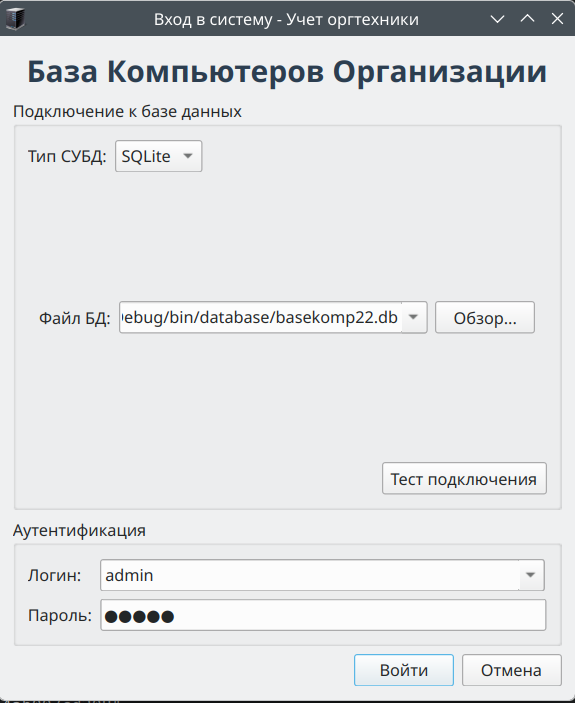   

СУБД пока только одна, sqlite. возможно впоследствии будет MySQL и PostgreSQL.  
База данных при первом входе создаётся автоматически, заполняется тестовыми данными.

	 	  
	 	

## **Модуль Учёт оргтехники**

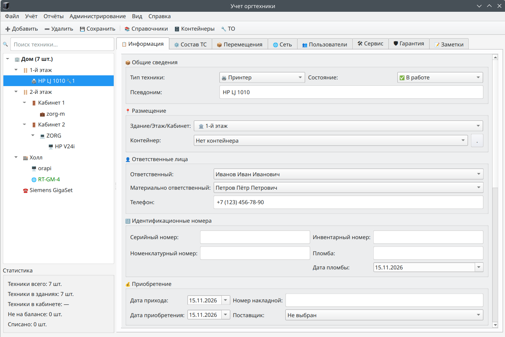   

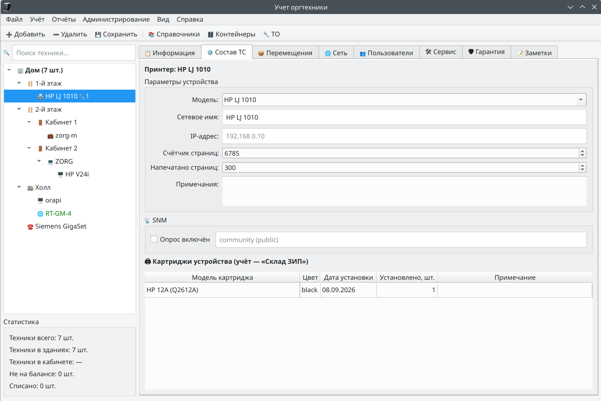   
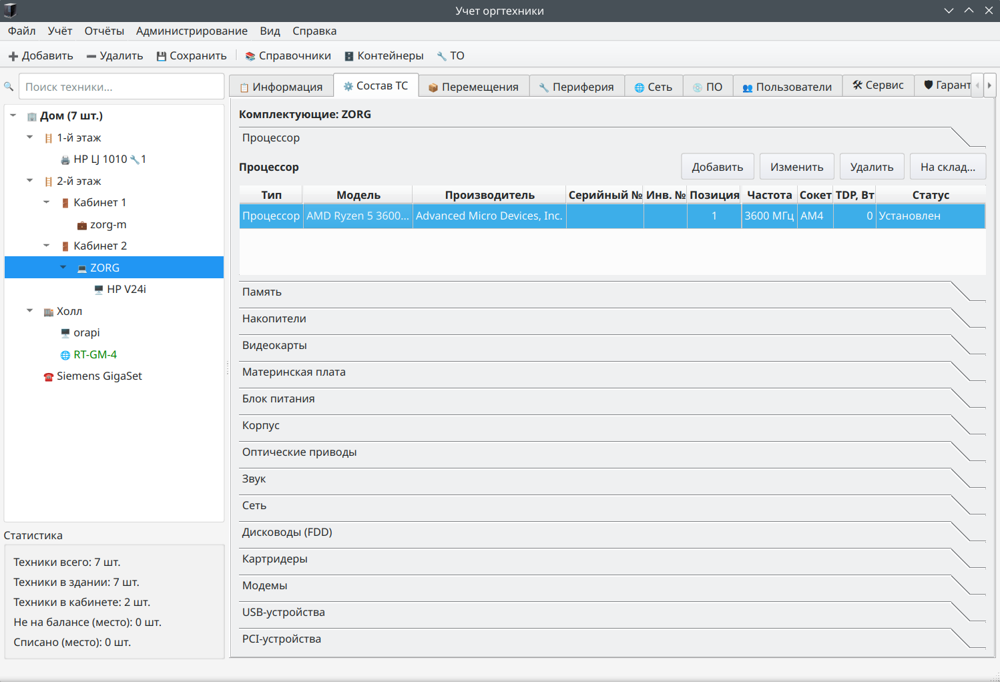   
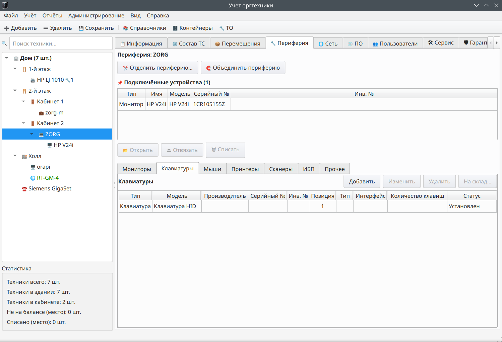   
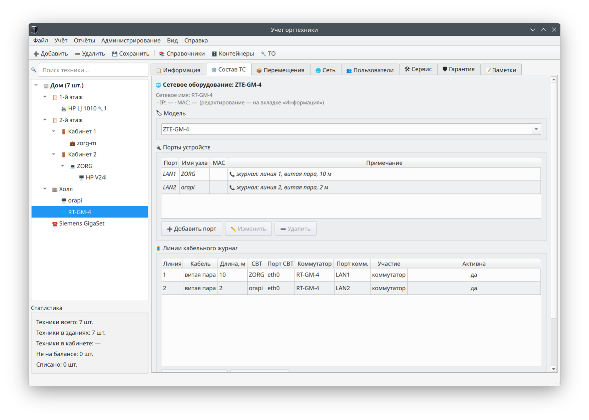   
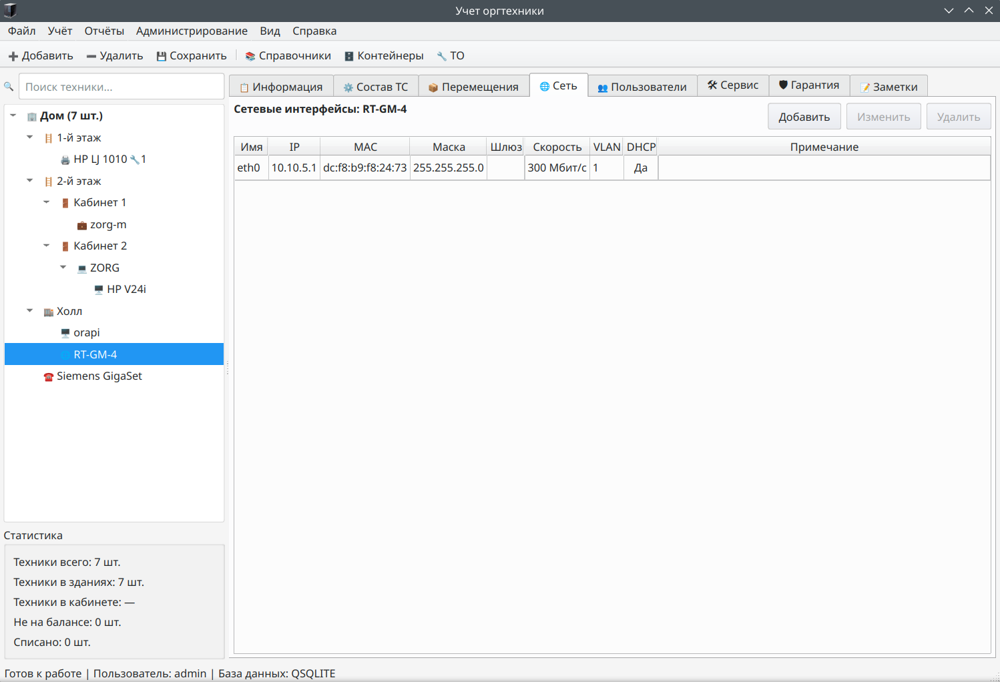   
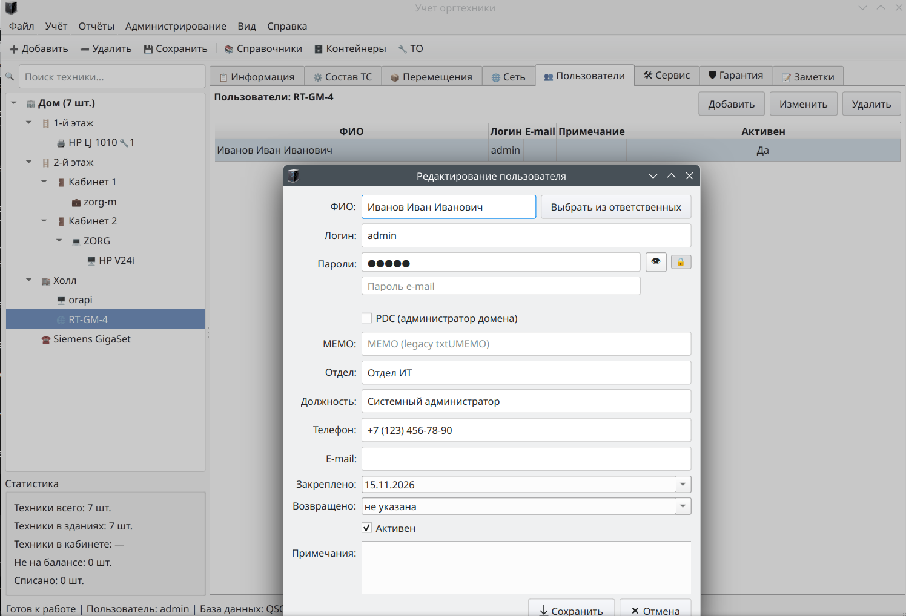   

## Справочники

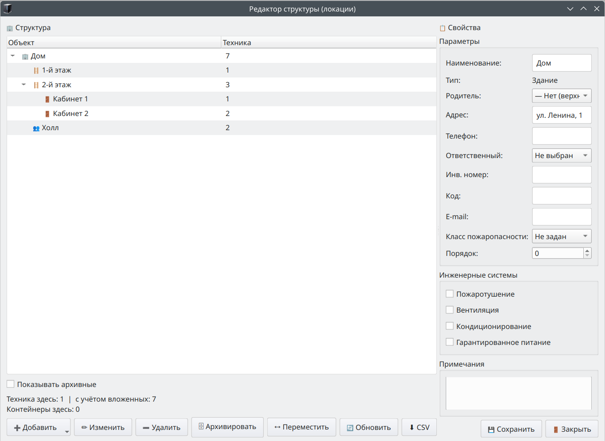   
   

## **Кабельный журнал**
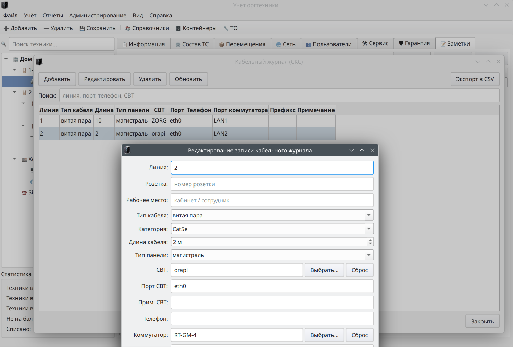   

## **Учёт заявок и ремонтов**
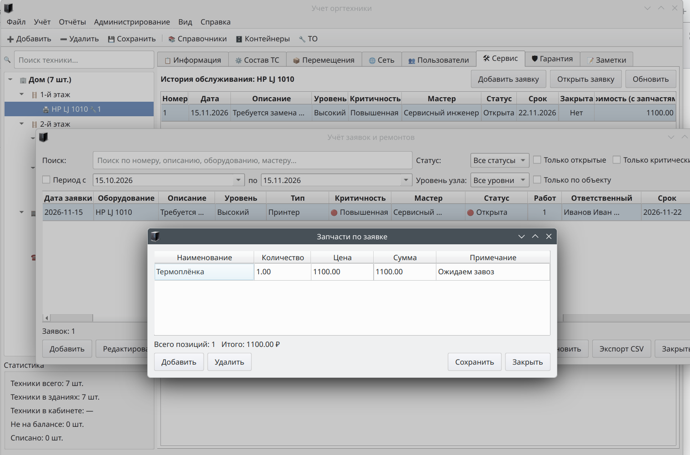   

## **Настройки**
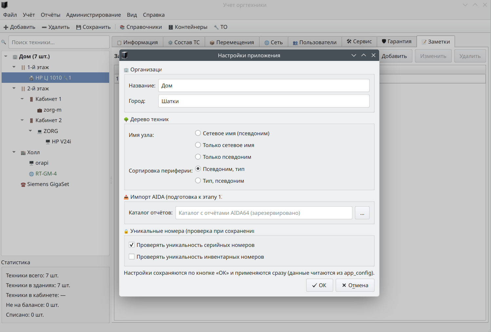   
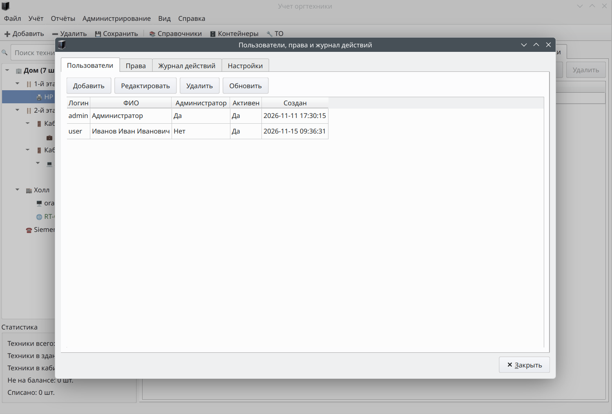   
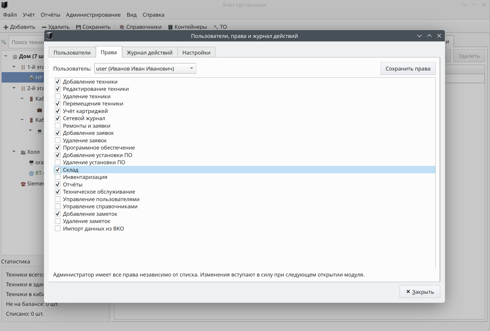   

## **Отчёты**
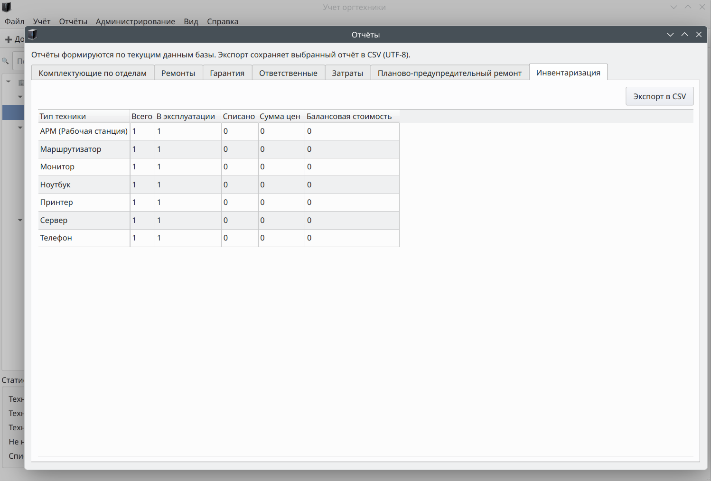   

# Миграция с БКО для Windows

Перенос данных возможен:

1. Дамп MySQL   
2. mdbtools  
   

**Скрипт для создания дампа базы mdb**  
*for t in \$(mdb-tables \-1 basekomp.mdb); do*  
  *echo "-- Table: \$t" \>\> data.sql*  
  *mdb-export \-I mysql basekomp.mdb "\$t" \>\> data.sql*  
*done*

*cat schema.sql data.sql \> full\_database.sql*

## Что работает на данный момент

1. Загрузка данных из AIDA64 (Everest), для Linux имеется скрипт на python собирающий данные в формате AIDA64;  
2. Обновление данных из AIDA64;  
3. Загрузка данных из БКО (через дамп), не всегда удачно, но работает;  
4. Учёт оргтехники;  
5. Учёт заявок;  
6. Склад (с учётом картриджей), при этом выдача со склада может быть сразу в технику, и соответственно возврат с техники на склад, ведется история выдачи;  
7. Отделение периферийных устройств от АРМ, присоединение обратно;  
8. Справочники;  
9. Перемещение техники в дереве (Drag\&Drop);  
10. Печатные формы;

## Вопросы:

* Будет ли дописана программа? Не знаю. Если хватит сил и терпения…  
* На чём пишется? На С++ в среде QT Creator.   
* Почему QT? Я не любитель GTK, мне нравится QT.  
* Почему нет исходного кода? Пока рано, стабильности нет, как будет стабильность, т.е. программа сможет работать без крахов, будет исходный код.

Тестирование проводится в дистрибутивах:

1. RedOS 8  
2. Ubuntu 26.04  
3. Debian 14

Лицензия программы остаётся прежней GNU GPL v2.  

